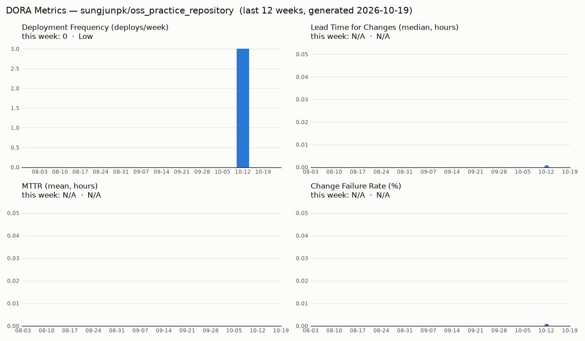
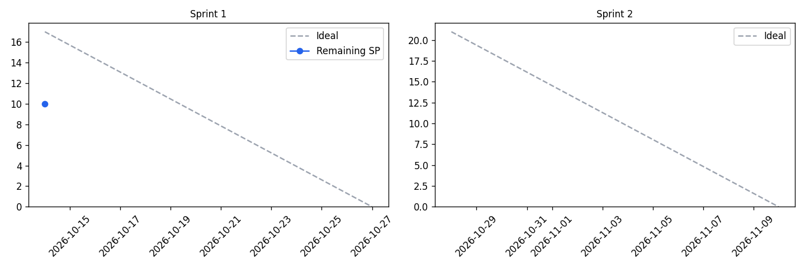

# oss_practice_repository

## 학기 프로젝트 제안서

### 1. 프로젝트명
**DeepTrader** — 딥러닝을 이용한 주식 자동 매매 기술 개발

### 2. 문제 정의
- 개인 투자자는 감정(공포·탐욕)에 휘둘린 매매, 정보 처리량의 한계, 장중 상시 모니터링 불가로 손실을 보기 쉽다.
- 기존 규칙 기반(이동평균 교차 등) 자동매매는 시장 국면이 바뀌면 성능이 급격히 떨어진다.
- 본 프로젝트는 과거 시세·거래량·기술적 지표를 학습한 딥러닝 모델로 단기 가격 방향을 예측하고,
  리스크 관리 규칙과 결합해 **감정 없이 일관된 매매를 수행하는 자동매매 시스템**을 만든다.
- 목표 지표: 백테스트 기준 Buy & Hold 대비 수익률·MDD(최대낙폭)·샤프지수 비교 우위 확인.
- 범위: 실계좌가 아닌 **모의투자 계좌**에서만 주문을 실행한다. (투자 권유 목적 아님)

### 3. 핵심 기능
1. **데이터 수집·전처리 파이프라인**
   일·분봉 시세 수집 → 결측치 처리·정규화 → 기술적 지표(RSI, MACD, 볼린저밴드 등) 피처 생성.
2. **딥러닝 가격 방향 예측 모델**
   LSTM / Transformer 기반 시계열 모델로 N일 뒤 상승·하락 확률 예측. 베이스라인(로지스틱 회귀·규칙 기반)과 성능 비교.
3. **백테스트 + 모의투자 자동매매 엔진**
   예측 신호 + 손절·익절·포지션 크기 규칙으로 매매. 수수료·슬리피지를 반영한 백테스트 후,
   증권사 모의투자 API로 실시간 주문 및 결과 대시보드 제공.

### 4. 기술 스택
| 영역 | 기술 |
|---|---|
| 언어 | Python 3.11 |
| 데이터 | pandas, NumPy, yfinance / FinanceDataReader, 한국투자증권 Open API(모의투자) |
| 모델 | PyTorch, scikit-learn(베이스라인·평가) |
| 백테스트 | backtrader 또는 자체 구현 |
| 시각화·대시보드 | matplotlib, Streamlit |
| 저장소 | SQLite(시세·거래 로그) |
| 협업·관리 | Git / GitHub (Issues, Projects), GitHub Actions(테스트) |

### 5. 16주 마일스톤 (초안)
| 주차 | 단계 | 내용 | 산출물 |
|---|---|---|---|
| 1 | 환경 구축 | Git/GitHub·SSH 설정, 저장소 생성, 첫 커밋 | 테스트 저장소 |
| 2 | 기획 | 제안서 작성, 주제·범위 확정 | 본 제안서 |
| 3 | 조사 | 시계열 예측·퀀트 관련 논문/사례 조사, 증권 API 조사 | 조사 노트 |
| 4 | 데이터 | 시세 수집 스크립트 작성, DB 저장 | 수집 모듈 |
| 5 | 데이터 | 전처리·기술적 지표 피처 생성, EDA | 피처 데이터셋 |
| 6 | 베이스라인 | 규칙 기반·로지스틱 회귀 모델, 평가 지표 정의 | 베이스라인 결과 |
| 7 | 모델 | LSTM 모델 구현·학습 | LSTM v1 |
| 8 | 중간 점검 | **중간 발표**, 베이스라인 대비 성능 비교 | 중간 보고서 |
| 9 | 모델 | Transformer 모델 실험, 하이퍼파라미터 튜닝 | 모델 비교표 |
| 10 | 백테스트 | 백테스트 엔진 구축(수수료·슬리피지 반영) | 백테스트 모듈 |
| 11 | 전략 | 손절·익절·포지션 크기 등 리스크 관리 규칙 | 매매 전략 v1 |
| 12 | 연동 | 모의투자 API 연동, 자동 주문 실행 | 자동매매 봇 |
| 13 | 대시보드 | Streamlit 수익률·거래 내역 대시보드 | 대시보드 |
| 14 | 검증 | 모의투자 실운영, 버그 수정, 테스트 보강 | 운영 로그 |
| 15 | 정리 | 결과 분석(수익률·MDD·샤프지수), 문서화 | README·보고서 |
| 16 | 마무리 | **최종 발표** 및 데모 | 발표 자료·최종 코드 |

### 6. 리스크 및 대응
- **과적합 / 미래 데이터 누수**: 시간순 train/validation/test 분리, walk-forward 검증.
- **예측 성능 한계**: 시장은 노이즈가 커서 정확도가 낮을 수 있음 → 수익률뿐 아니라 리스크 지표로 평가하고, 결과가 부정적이어도 분석 자체를 산출물로 삼는다.
- **API 제약**: 호출 제한·인증 이슈 → 초기에 모의투자 API 연동을 미리 테스트.

---

## DORA 지표 대시보드

`.github/workflows/dora.yml` 이 `main` push 와 매주 월요일마다 [`scripts/dora.py`](scripts/dora.py) 를 실행해 DORA 4대 지표를 수집한다.

| 지표 | 수집 방법 |
|---|---|
| Deployment Frequency | `main` push 1회 = 배포 1건 (Actions 실행 이력) |
| Lead Time for Changes | 배포에 포함된 커밋 작성 시각 → push 시각 (중앙값) |
| Change Failure Rate | `incident` 라벨 이슈 수 / 배포 수 |
| MTTR | `incident` 이슈 open → close 시간 (평균) |

- 매 실행 결과는 JSON 아티팩트(`dora-metrics-<번호>`)로 Actions 에 90일 보관된다.
- 매주 월요일 09:00(KST)에 [`dora/REPORT.md`](dora/REPORT.md)(주간 보고서), `dora/metrics.json`, `dora/dashboard.png` 가 자동 커밋된다.
- 장애 기록: 이슈를 열고 `incident` 라벨을 붙인다 → 복구 후 닫으면 MTTR 에 반영.

---

## 스프린트 운영 (칸반)

- 보드: [DeepTrader Kanban](https://github.com/users/sungjunpk/projects/6) — `Backlog → To Do → In Progress → Review → Done`
- 스프린트 = 마일스톤 2개 (Sprint 1: 10/14~10/27, Sprint 2: 10/28~11/10), 스토리 포인트 = 보드의 `Estimate` 필드
- 이슈 템플릿: Bug / Feature (`.github/ISSUE_TEMPLATE/`)
- 라벨: `type:*`(bug·feature·docs·chore) · `area:*`(data·model·backtest·infra) · `priority:*`(high·medium·low) · `incident`(DORA)
- 구성 스크립트: [`scripts/setup_board.py`](scripts/setup_board.py) (재실행 안전)
- 지표: `python scripts/sprint_metrics.py` → [`sprint/REPORT.md`](sprint/REPORT.md) (Cycle Time · Velocity · Burndown)

