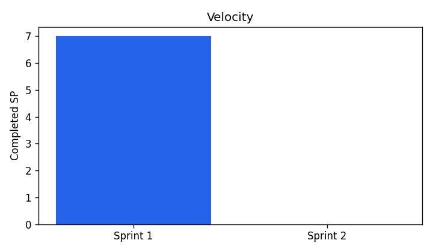

# 스프린트 지표 (2026-10-14)

`python scripts/sprint_metrics.py` 로 생성. 정의는 스크립트 상단 docstring 참고.

## Velocity

| 스프린트 | 기간 | 계획 SP | 완료 SP |
|---|---|---|---|
| Sprint 1 — 기획·환경·데이터 수집 | 2026-10-14 ~ 2026-10-27 | 17 | 7 |
| Sprint 2 — 전처리·베이스라인 | 2026-10-28 ~ 2026-11-10 | 21 | 0 |

종료된 스프린트 없음 — 평균 Velocity 는 Sprint 1 마감 후 산출.

## Burndown

| 스프린트 | 오늘 남은 SP |
|---|---|
| Sprint 1 — 기획·환경·데이터 수집 | 10 |
| Sprint 2 — 전처리·베이스라인 | - |

## Cycle Time

- 완료 이슈 4건, 중앙값 0.0h, 평균 0.0h

| # | 이슈 | SP | 시작 | 완료 | Cycle Time |
|---|---|---|---|---|---|
| #1 | [Chore] Git/GitHub 환경 구축 및 저장소 생성 | 1 | 10-14 15:25 (생성) | 10-14 15:25 | 0.0h |
| #2 | [Docs] 학기 프로젝트 제안서 작성 | 2 | 10-14 15:25 (생성) | 10-14 15:25 | 0.0h |
| #3 | [Feature] DORA 4대 지표 수집 워크플로우 | 3 | 10-14 15:25 (생성) | 10-14 15:26 | 0.0h |
| #4 | [Bug] DORA 대시보드 라인 차트 x축 누락 | 1 | 10-14 15:26 (생성) | 10-14 15:26 | 0.0h |
